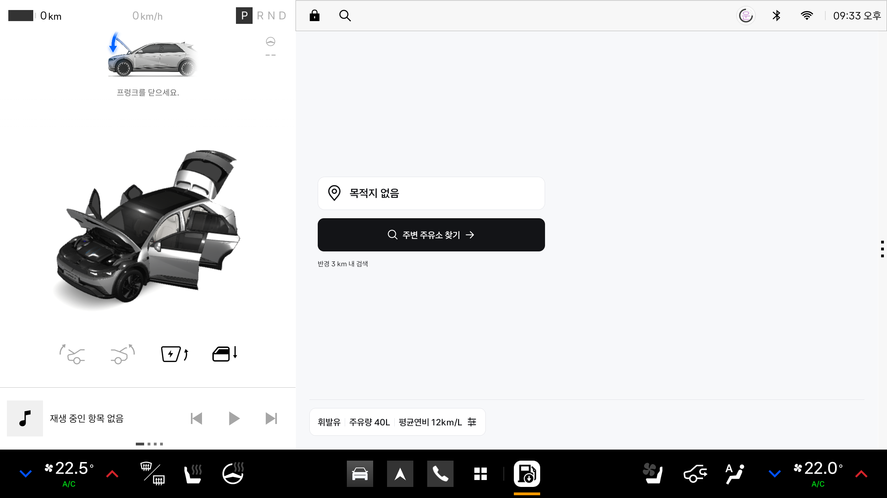
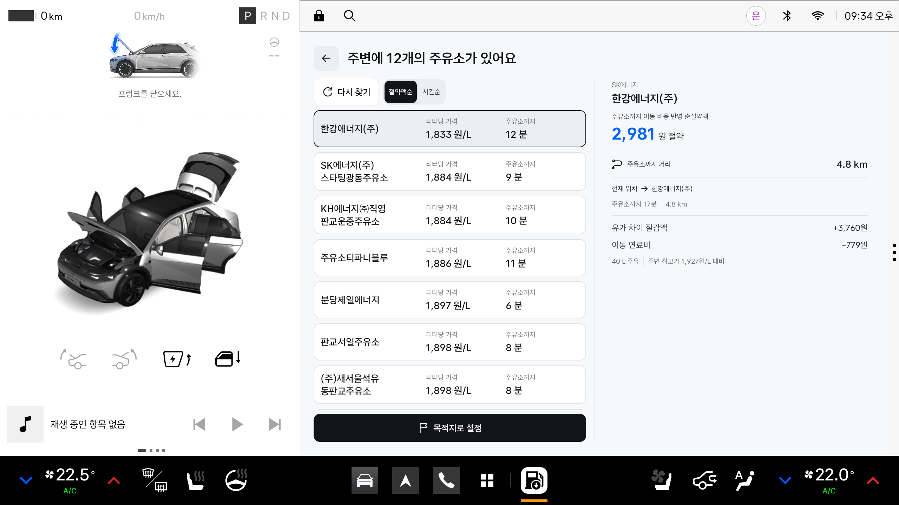
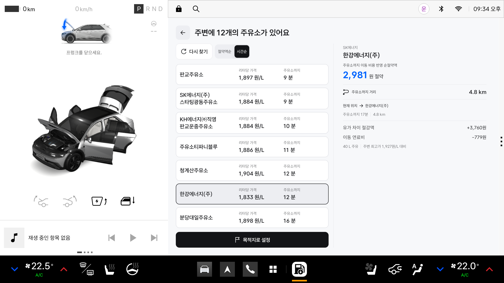
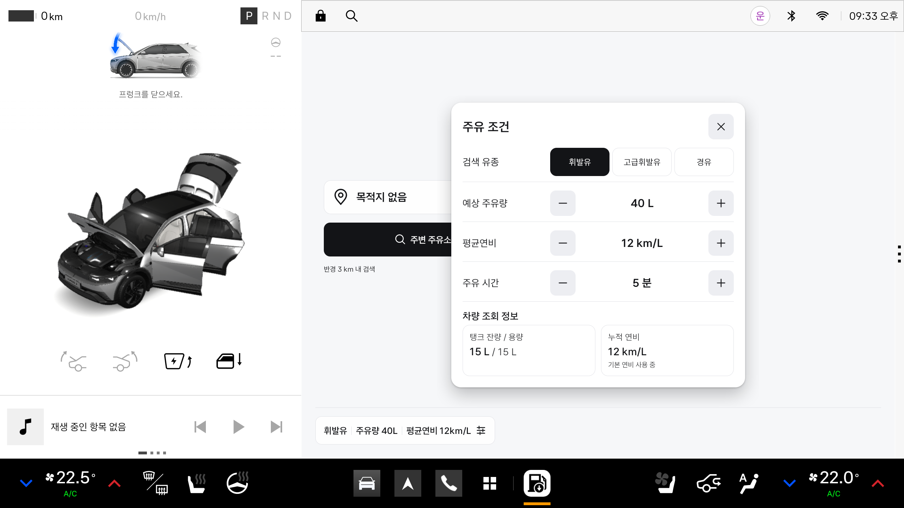
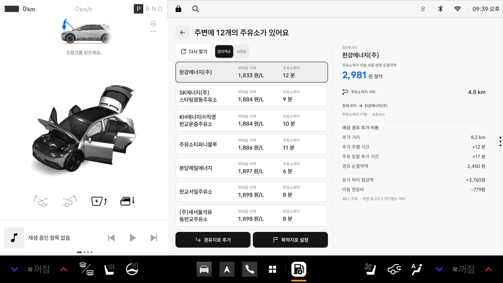
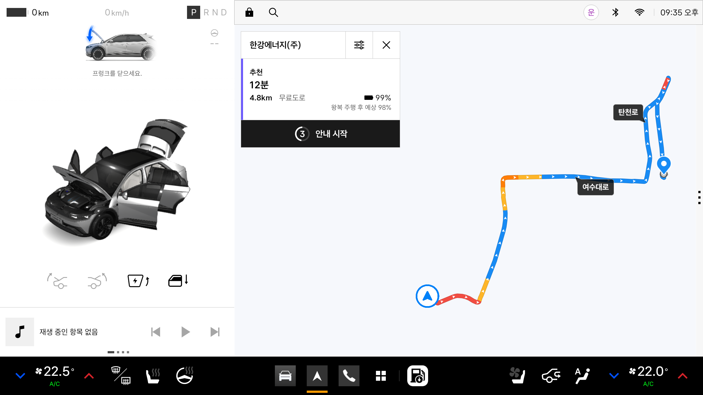

# 주유로 (JuyuLow)

### 돌아갈 만큼 싼가?

**주유 가격과 이동에 드는 연료비·시간을 함께 비교하는 Pleos Connect 차량용 앱**

리터당 80원이 저렴한 주유소를 발견했습니다. 하지만 그곳까지 가려면 10km를 이동해야 합니다. 이번에 넣을 양이 10L라면, 그래도 이득일까요?

주유로는 주유소별 가격에 차량 연비와 예상 주유량, 실제 도로 이동거리·시간을 연결합니다. 운전자는 **얼마를 아낄 수 있는지, 얼마나 이동해야 하는지** 확인하고 선택한 주유소를 차량 내비게이션에 바로 반영할 수 있습니다.

*이번 주유량과 이동 비용을 기준으로, 나에게 유리한 주유소를 비교합니다.*

현대자동차그룹 차량용 앱 개발 공모전 출품 프로젝트입니다. 현재 오피넷 실제 검색과 Pleos 내비게이션을 연결한 **정차 시연용 Android 앱**으로 구현했으며, 경유 추가 비용 추정은 카카오 API 키가 설정된 debug·release·qaRelease 빌드에서 제공합니다. 구현 범위는 [현재 구현과 검증](#현재-구현과-검증)에 정리했습니다.

## 시연 영상

[](https://youtu.be/JHTOHap73KA)

[▶ YouTube에서 시연 영상 재생](https://youtu.be/JHTOHap73KA)

## 상황별 사용 시나리오

### 1. 출발 전, 주유소를 새 목적지로 정합니다

**상황:** 별도로 설정한 목적지는 없고, 우선 주유부터 하려 합니다.

1. 홈에서 목적지 유무와 주유 조건을 확인합니다.
2. **주변 주유소 찾기**를 실행합니다.
3. 후보별 가격·도착 시간과 상세 비용을 비교합니다.
4. 한 곳을 선택하고 **목적지로 설정**을 누릅니다.
5. 설정 완료 화면에서 내비게이션을 엽니다.



*홈에서 목적지 상태와 주유 조건을 확인하고, 검색 시 차량의 현재 위치를 기준으로 비교를 시작합니다.*

> 사진은 Pleos Connect 에뮬레이터의 정차 시연 화면입니다. 표시된 유가·시간·절약액은 촬영 당시 예시이며 최신 조회값을 보장하지 않습니다.

### 2. 가격은 더 싸지만, 이동 비용까지 보면 가까운 곳이 유리합니다

**상황:** 멀리 있는 주유소가 가장 저렴하지만, 이번에는 소량만 주유할 예정입니다.

비교 목록에서 후보를 선택하면 같은 화면의 상세가 바뀝니다. 리터당 가격과 함께 **유가 차이 절감액·이동 연료비·예상 순절약액**을 확인할 수 있습니다. 계산 결과가 음수이면 **“원 더 들어요”**로 표시합니다.



*선택한 주유소의 순절약액과 이동 연료비를 목록 옆에서 확인합니다.*

아래는 계산 원리를 보여주는 가상 예시입니다. 예상 주유량 20L, 연비 12km/L, 기준 유가 1,800원/L이며 통행료는 제외했습니다.

| 후보 | 판매 가격 | 주유소까지 도로 거리 | 유가 차이 절감액 | 이동 연료비 | 예상 순절약액 |
| --- | ---: | ---: | ---: | ---: | ---: |
| A 주유소 | 1,800원/L | 1km | 0원 | 150원 | −150원 |
| B 주유소 | 1,760원/L | 2km | 800원 | 300원 | **500원** |
| C 주유소 | **1,720원/L** | 10km | 1,600원 | 1,500원 | 100원 |

이 조건에서는 **B 주유소**의 예상 순절약액이 가장 큽니다. 같은 예시에서 10L만 넣으면 C의 예상 순절약액은 −700원, 40L를 넣으면 1,700원으로 바뀝니다. 주유량에 따라 선택도 달라질 수 있습니다.

*가격 차이로 아끼는 금액에서 이동 연료비를 뺀 결과를 확인합니다.*

### 3. 약속 시간이 가까워, 빨리 도착할 수 있는 곳을 고릅니다

**상황:** 조금 더 절약하는 것보다 빠르게 주유소에 도착하는 것이 중요합니다.

목록을 **절약액순**과 **시간순**으로 바꾸며 비교할 수 있습니다. 정렬을 바꾸더라도 선택한 주유소는 유지되므로, 현재 선택을 다른 후보와 계속 비교할 수 있습니다.

조회 중 사용자 조작이 없으면 응답 갱신마다 현재 정렬의 최상단 후보를 자동 선택하고 목록도 맨 위로 이동합니다. 터치·키 입력·스크롤·직접 선택·정렬 변경 후에는 자동 선택을 멈추고 현재 선택을 유지합니다. 재검색에 성공하면 새 검색에 자동 선택을 다시 적용합니다.



목록의 **주유소까지** 시간은 주행 ETA이며, 상세의 소요시간에는 설정한 주유 정차 시간이 포함됩니다. 시간은 금액과 별도로 보여주며, 순절약액에 시간 비용을 차감하지 않습니다.

*절약액과 도착 시간을 함께 보고, 오늘의 우선순위에 맞게 선택합니다.*

### 4. 가득 넣을지, 필요한 만큼만 넣을지 조건을 바꿉니다

**상황:** 차량의 남은 연료를 확인한 뒤, 이번에는 가득 주유하지 않고 필요한 만큼만 넣으려 합니다.

탱크 용량·잔량은 참고 정보로 확인하고, 이번 예상 주유량은 직접 설정합니다. 연비는 차량에서 조회한 누적 연비를 사용하며, 조회하지 못하거나 유효하지 않으면 저장된 수동 평균연비를 사용합니다.

사용자는 주유 조건에서 검색 유종, 예상 주유량, 수동 평균연비와 주유 시간을 조정할 수 있습니다. 검색 반경은 3km로 고정됩니다. **변경 즉시 저장되며, 다음 검색에서 모든 후보에 같은 조건이 사용됩니다.**

> **설정 화면의 수동 연비는 현재 개발 에뮬레이터의 데이터 제공 제약을 보완하기 위한 값입니다.**
>
> 현재 개발에 사용한 **Pleos Connect 2.1.0 에뮬레이터는 아이오닉 5 전기차 기반**이며, 제공된 환경에서 내연기관 차종으로 전환해 실제 연료·연비 데이터를 검증할 수 없어 수동값으로 시연합니다. **앱의 Vehicle SDK 조회와 누적 연비 자동 반영 경로는 구현되어 있습니다.** 지원 환경에서 유효한 누적 연비가 조회되면 수동 평균연비보다 우선하여 순절약액 계산에 사용합니다. 내연기관 데이터 기반 실동작 검증은 해당 데이터를 제공하는 환경에서 진행할 과제입니다.



차량 정보 연동에는 아래 SDK 값과 차량 속성을 사용합니다. 값의 지원 여부와 읽기 가능 여부를 확인한 뒤 조회하며, 누적 연비가 없거나 유효하지 않으면 저장된 수동 평균연비로 비교를 이어갑니다.

| 차량 정보 | SDK API·속성과 원본 값 | 현재 앱에서의 사용 |
| --- | --- | --- |
| 누적 연비 | `getCumulativeFuelEconomy()`의 `Float?`, L/100km | 조회 성공값을 `100 ÷ 값`으로 km/L로 변환해 순절약액 계산에 자동 반영 |
| 현재 주행 세션 연비 | `getCurrentFuelEconomy()`의 `Float?`, L/100km | 조회 구현. 현재 순절약액 계산에는 누적 연비 또는 수동 평균연비를 사용 |
| 연료 잔량 비율 | `getFuelPercent()`의 `Int?`, % | 조회 구현. 예상 주유량을 이 값으로 자동 변경하지 않음 |
| 탱크 잔량·용량 | AAOS `FUEL_LEVEL`·`INFO_FUEL_CAPACITY`, mL | L 단위로 변환해 설정 화면의 참고 정보로 표시 |

공식 [FuelEconomyListener](https://document.pleos.ai/docs/pleos-only/connect-sdk-pleos/Vehicle/vehicle/ai.pleos.playground.vehicle.listener/fuel-economy-listener/entry)의 연비 갱신 콜백은 `onFuelEconomyUpdated(efficiency: Float?)`이며 `efficiency`의 단위는 L/100km입니다. 연비 갱신을 받는 어댑터도 구현했으며, **현재 앱의 계산 흐름은 프로세스 시작 시 1회 조회한 값을 사용**합니다. SDK 연동 계약과 지원 조건은 [차량 정보 연동 문서](docs/LOCATION_VEHICLE.md)를 참고합니다.

| 설정 | 현재 지원 범위 |
| --- | --- |
| 검색 유종 | 휘발유·고급휘발유·경유 |
| 검색 반경 | 3km 고정 |
| 예상 주유량 | 수동 설정, 10~100L (10L 단위) |
| 예상 연비 | 차량 누적 연비 우선, 미확보 시 수동 설정값 (1~30km/L) |
| 주유 정차 시간 | 1~20분, 기본 5분 |

*차량 정보와 운전자의 계획을 이번 주유의 계산 조건으로 사용합니다.*

### 5. 원래 목적지를 유지하면서, 가는 길에 주유합니다

**상황:** 목적지가 이미 설정돼 있고, 도착하기 전에 주유소에 들르려 합니다.

1. 홈에서 기존 내비게이션 목적지를 확인합니다.
2. 주변 주유소를 검색하고 후보를 비교합니다.
3. 경유 추정이 제공되는 경우, 상세에서 **추가 거리·추가 주행 시간·주유 포함 추가 시간·경유 순절약액**을 확인합니다.
4. **경유지로 추가**를 선택합니다.
5. 기존 목적지를 유지한 채 주유소가 추가됐는지 확인하고 내비게이션을 엽니다.

*기존 목적지까지 바로 갈 때와 주유소를 거쳐 갈 때의 거리·시간 차이를 별도로 확인합니다.*



*편도 순절약액과 별도로, 기존 목적지까지 경유할 때의 추가 거리·시간과 경유 순절약액을 확인합니다.*

> **현재 비교 방식:** 목록 정렬과 상단의 큰 순절약액은 **주유소까지 편도 이동 기준**입니다. 카카오 경유 추정치는 상세의 별도 영역에 표시하며 목록 순위에는 반영하지 않습니다. 경유 추정은 카카오모빌리티 경로 기준이므로 실제 Pleos 안내 경로와 다를 수 있습니다.

검색 대상은 차량의 현재 위치 반경 3km 안에서 가격·좌표가 유효한 가까운 최대 15곳입니다. 기존 목적지가 있으면 이 후보들을 거쳐 갈 때의 추가 비용을 별도로 추정합니다. 목적지까지의 전체 경로를 따라 후보를 찾는 기능은 후속 개발 범위입니다.

경유지 추가는 **기존 목적지가 있고 기존 경유지가 없을 때** 제공합니다. 그 외에는 주유소를 목적지로 설정할 수 있으며, 기존 목적지를 대체할 때는 확인 절차를 거칩니다.

*비교한 주유소를 다시 검색하지 않고 차량 내비게이션으로 연결합니다.*

### 선택한 주유소로 내비게이션을 연결합니다



*주유소를 새 목적지로 설정한 뒤 Pleos 내비게이션에서 경로를 확인합니다.*

## 왜 주유로인가요?

주유소의 표시 가격만으로는 이번 주유의 총지출을 알기 어렵습니다. 가격 차이가 같아도 조금만 넣는지, 가득 넣는지에 따라 이동할 가치가 달라집니다. 연비가 낮거나 이동거리가 길다면 가격 차이로 아낀 금액보다 이동 연료비가 더 클 수도 있습니다.

주유로의 비교 단위는 **이번 주유량과 내 차량 연비에서 이동 연료비를 부담하고도 남는 예상 금액**입니다. 가격·위치 검색이나 내비게이션 연결 자체보다, 운전자가 따로 계산해야 했던 주유량·연비·도로 이동 비용을 같은 화면에서 비교하는 데 초점을 둡니다.

| 운전자의 질문 | 주유로에서 확인하는 정보 |
| --- | --- |
| 저렴한 곳까지 이동하면 얼마나 남을까? | 유가 차이 절감액에서 이동 연료비를 차감한 예상 순절약액 |
| 지금은 시간이 더 중요한데? | 주유소까지의 예상 도착 시간과 시간순 정렬 |
| 조금만 넣을 때도 같은 곳이 유리할까? | 이번 예상 주유량을 반영한 비교 |
| 원래 가려던 곳에 가면서 주유할 수 있을까? | 기존 목적지를 유지하는 경유지 추가와 별도의 경유 비용 추정 |

## 차량 안에서 이어지는 경험

주유로는 **차량 정보 확인 → 주유소 검색 → 비용·시간 비교 → 내비 경로 반영**을 하나의 흐름으로 연결합니다.

차량에서 조회한 누적 연비와 현재 내비게이션 상태를 비교에 연결하고, 선택한 주유소를 다시 검색하지 않고 같은 차량의 내비게이션에 반영합니다. 출발 전 정차 상태에서 비교·선택한 뒤 길 안내로 이어지는 흐름이 기본 사용 맥락입니다.

| 차량 환경에 맞춘 요소 | 구현 방식 |
| --- | --- |
| 차량 정보 활용 | 누적 연비를 계산에 사용하고 미확보 시 수동 연비로 보완, 탱크 잔량·용량은 참고 정보로 표시 |
| 도로 기준 비교 | 단순 직선거리 대신 NaviHelper의 주유소까지 도로 거리·ETA 사용 |
| 적은 화면 이동 | 목록과 선택 후보 상세를 같은 화면에 배치 |
| 입력 부담 감소 | 주유 조건에 증감 버튼과 선택 조작 제공 |
| 차량 창 크기 대응 | 가로형과 분할 창에서 목록·상세 확인 및 하단 경로 설정 버튼 제공 |
| 내비게이션 연결 | 선택한 주유소를 목적지로 설정하거나 기존 목적지의 경유지로 추가 |

방향키로 선택 가능한 주유소에 포커스를 옮기면 오른쪽 상세가 갱신됩니다. 주유소에서 Enter를 누르면 경유 추가 버튼으로 포커스를 옮기고, 경유 추가가 불가능하면 목적지 설정 버튼으로 옮깁니다. 경로는 해당 버튼을 실행할 때 반영됩니다.

*차량의 가로형 앱 영역과 분할 창 모두에서 비교와 경로 선택을 이어갑니다.*

현재 시연은 정차 상태를 기준으로 합니다. 실차 동작과 주행 중 사용 적합성은 별도 검증 대상입니다.

## 예상 순절약액은 어떻게 계산하나요?

### 주유소까지 편도 비교

```text
유가 차이 절감액 = (기준 유가 − 후보 유가) × 예상 주유량
이동 연료비 = 주유소까지 도로 거리 ÷ 예상 연비 × 기준 유가
예상 순절약액 = 유가 차이 절감액 − 이동 연료비
```

- **기준 유가:** 같은 검색 결과에서 경로를 확보한 후보 중 최고가입니다. 전체 지역의 최고가나 운전자가 원래 이용했을 주유소 가격을 뜻하지 않습니다.
- **시간:** 이동·주유에 드는 시간은 별도로 안내하며 금액으로 환산하지 않습니다.
- **통행료:** 현재 Pleos 편도 비교에서는 미확보 항목으로 계산에서 제외합니다. 0원 확인을 뜻하지 않습니다.
- **표시 금액:** 위 기준에 따른 추정치이며, 가까운 다른 주유소를 이용할 때와의 실제 지출 차이를 보장하는 금액은 아닙니다.

표시 금액은 동일 검색 조건에서 후보를 비교하기 위한 지표입니다. 실제 주유 영수증의 절감액과 구분하며, 실제 지출 감소 효과는 별도 검증 대상입니다.

### 개발·시연용 경유 비교

```text
추가 거리·시간·통행료 = 카카오 경유 경로 − 카카오 기준 경로
경유 순절약액 = 유가 차이 절감액
             − 추가 거리의 연료비 − 통행료 차이
```

같은 출발 위치·목적지·옵션으로 조회한 카카오 결과끼리 차감합니다. 상세에는 추가 주행 시간과 주유 정차 시간을 더한 추가 시간을 구분해 표시합니다. 통행료 차이는 경유 순절약액 계산에 반영하지만 별도 항목으로 표시하지 않으며, 시간 비용은 차감하지 않습니다. Pleos 편도 수치와 카카오 경유 수치를 서로 차감하지 않습니다.

## 실행 및 테스트 환경

- **제출 APK:** [eotaek_juyulow_release.apk 다운로드](https://github.com/EoTaek/juyulow/releases/download/v0.1.0/eotaek_juyulow_release.apk) · [v0.1.0 Release](https://github.com/EoTaek/juyulow/releases/tag/v0.1.0) · [저장소 내 APK](apk/eotaek_juyulow_release.apk)
- **실행 방법:** 제출 APK를 Pleos Connect 에뮬레이터에 설치한 뒤 앱 목록에서 **주유로**를 실행합니다. 주유 조건을 확인하고 **주변 주유소 찾기**를 누르면 비교를 시작할 수 있습니다. 소스에서 직접 빌드하는 방법과 API 키 설정은 아래 개발 안내를 참고합니다.
- **개발 에뮬레이터:** Pleos Connect **2.1.0**, Android 14, Pleos Connect-S-17
- **앱 화면 규격:** 가로형 **1700 × 1184dp**, 분할 창 **840 × 1184dp**. 실제 디스플레이의 픽셀 해상도가 아닌 앱의 논리 영역입니다.
- **필요한 설정:** 정차 상태에서 시연하며, 주유소 검색과 경로 조회를 위해 네트워크와 현재 위치가 필요합니다. 앱에서 차량 에너지 접근 권한을 요청하면 허용해 주세요.

### 로컬 APK 빌드

Git에서 제외된 `local.properties`에 `OPINET_API_KEY`를 설정합니다. 경유 비용 추정도 시연하려면 `KAKAO_REST_API_KEY`가 필요하며, 키가 설정된 debug·release·qaRelease 빌드에서 동일하게 제공됩니다.

| 빌드 | Gradle 태스크 | APK 경로 (`app/build/outputs/apk/` 아래) | 용도 |
| --- | --- | --- | --- |
| `debug` | `:app:assembleDebug` | `debug/app-debug.apk` | 개발·시연, 카카오 키 설정 시 경유 비용 추정 제공 |
| `qaRelease` | `:app:assembleQaRelease` | `qaRelease/app-qaRelease.apk` | release 최적화·로그 비활성화, 로컬 debug 키 서명, 카카오 키 설정 시 경유 비용 추정 제공 |
| `release` | `:app:assembleRelease` | `release/app-release-unsigned.apk` | 별도 서명이 필요한 산출물 |

저장소의 Gradle Wrapper로 실행하며 Windows 빌드 환경과 서명 제약은 [로컬 QA release 빌드](docs/PROJECT.md#로컬-qa-release-빌드)를 참고합니다. `qaRelease`는 debug와 패키지명이 같아 병렬 설치되지 않으며, 기존 앱과 서명이 같을 때 데이터를 유지하며 교체할 수 있습니다. 로컬 QA 서명은 배포용 서명이 아닙니다.

QA 빌드·서명·DEX 검사 결과는 [검증 문서](docs/TESTING.md)에 기록돼 있으며, 해당 QA APK의 장치 설치·실행은 검증하지 않았습니다.

### 에뮬레이터 시연 안내

현재 개발에 사용한 아이오닉 5 기반 에뮬레이터의 내연기관 데이터 제공 제약과 구현된 SDK 연동은 위 [주유 조건 화면](#4-가득-넣을지-필요한-만큼만-넣을지-조건을-바꿉니다)에 구분해 설명했습니다. **검색 유종과 예상 주유량을 직접 선택하고, 차량 누적 연비를 가져오지 못하면 수동 평균연비로 시연**합니다. 예를 들어 휘발유, 40L, 12km/L로 설정할 수 있습니다. 주유량은 현재 앱 설계상 수동 설정이며, 유효한 차량 누적 연비가 조회되면 해당 연비를 자동 적용합니다. 에너지원이 전기로 표시될 수 있지만 전기차 충전 비교 기능을 의미하지는 않습니다.

기존 목적지가 있을 때 경유지 추가를 시연할 수 있으며, 기존 경유지가 없어야 합니다. 경유 추가 비용 추정은 카카오 API 키가 설정된 **debug·release·qaRelease 빌드**에서 제공됩니다. 개발 설정은 [카카오 연동 문서](docs/KAKAO.md)를 참조합니다.

## 현재 구현과 검증

### 구현 범위

| 기능 | 현재 상태 |
| --- | --- |
| 주변 주유소·유가 검색 | 오피넷 실제 반경 검색, 가까운 유효 후보 최대 15곳 비교 |
| 검색 조건 | 휘발유·고급휘발유·경유 선택 저장, 반경 3km 고정 |
| 차량 정보 | 앱 프로세스 시작 시 Pleos Vehicle·AAOS 1회 조회, 누적 연비 미확보 시 수동 연비 사용 |
| 주유소까지 거리·ETA | 오피넷 좌표를 변환해 NaviHelper로 조회 |
| 점진적 결과 표시 | 첫 ETA 성공 후 비교 화면 진입, 나머지 후보를 순차 갱신 |
| 비용 비교 | 편도 기준 순절약액·비용 내역, 절약액순·시간순 정렬 |
| 경유 추가 비용 | 카카오 API 키가 설정된 빌드에서 기준 경로와 경유 경로의 차이 추정 |
| 내비게이션 반영 | Pleos 목적지 설정·조건부 경유지 추가, 반영 확인 후 완료 표시 |
| 왕복·전기차 충전 비교 | 후속 개발 범위 |

조회 중인 후보와 경로 조회에 실패한 후보는 상태를 구분합니다. 경로 미확보 후보에는 거리·시간·절약액을 임의로 부여하지 않으며 내비 설정에서도 제외합니다. 카카오 경유 추정이 요청된 후보는 해당 조회가 끝나야 선택할 수 있으며, 추정에 실패하면 Pleos 편도 비교를 사용할 수 있습니다.

검색 중에는 경로를 확보한 후보가 늘면서 기준 유가와 순절약액이 바뀔 수 있습니다. 화면에 잠정값 안내 문구는 표시하지 않으므로, 비교 금액을 확인할 때 후보 조회가 끝났는지 함께 확인해야 합니다.

유가는 오피넷 반경 검색값을 사용합니다. 현재 결과 화면에는 데이터 출처·조회 시각·가격 기준시각 미제공 안내를 표시하지 않습니다. API 응답에서 가격 기준시각을 제공하지 않으므로 실시간 가격을 보장하지 않습니다.

### 검증 기록

저장소의 [검증 문서](docs/TESTING.md)에는 다음 결과가 기록돼 있습니다.

- 빌드·단위 테스트·lint 수행 및 검색·계산·설정 저장·실패 처리 검증
- Pleos Connect 2.1.0 에뮬레이터에서 실제 오피넷 후보의 좌표 기반 목적지 설정·경유지 추가·원래 경로 복원 확인
- 실제 위치·목적지·오피넷 후보를 연결한 **debug 통합 시험**에서 12개 후보의 Pleos 편도 ETA와 카카오 경유 추정이 모두 성공

위 실 API·SDK 연동 수치는 해당 에뮬레이터와 시점의 debug 시험 결과입니다. release·qaRelease의 빌드·단위 테스트 등 확인 범위는 [검증 문서](docs/TESTING.md)에 별도로 기록합니다. debug의 실연동 결과가 제출 release APK의 설치·실 API 호출까지 검증했다는 뜻은 아니며, 실차 호환성·다른 내비 버전·실제 절약 효과도 별도 검증 대상입니다.

## 기술 구성

| 영역 | 기술·역할 |
| --- | --- |
| 차량 앱 | Kotlin, Jetpack Compose, Navigation 3 |
| 상태·의존성 | ViewModel, Coroutines / Flow, Koin |
| 차량·내비 | Pleos Vehicle·Android Automotive OS의 차량 정보, NaviHelper의 위치·경로 조회 및 내비 설정 |
| 위치 SDK 어댑터 | Pleos FusedLocation 조회·구독 어댑터 구현, 현재 검색 위치는 NaviHelper에서 조회 |
| 주유소 데이터 | 오피넷 Open API, Proj4J 좌표 변환 |
| 경유 추정 | 카카오모빌리티 자동차 길찾기 API — 키가 설정된 debug·release·qaRelease |
| 통신·저장 | Retrofit, Kotlin Serialization, Preferences DataStore |

| 모듈 | 역할 |
| --- | --- |
| `app` | SDK 어댑터, 의존성 조립, 앱 화면 연결 |
| `feature:main` | 홈·비교·완료·주유 조건 화면과 상태 관리 |
| `core:model` | 계산 조건, 차량·경로 모델, 비용 계산 |
| `core:data` | 외부 API·검색 세션·설정 저장소 |
| `core:design` | 공통 테마·UI 컴포넌트 |

기술 상세와 개발·검증 방법은 [프로젝트 문서](docs/PROJECT.md), [검증 문서](docs/TESTING.md), [오피넷 연동](docs/OPINET.md), [내비 연동](docs/NAVIHELPER.md), [카카오 경유 추정](docs/KAKAO.md)에서 확인할 수 있습니다.

## 초기 사용자와 서비스 검증 계획

초기 검증 대상은 정기적으로 주유하며 가격과 이동거리를 비교하는 Pleos Connect 내연기관 차량 운전자입니다. 주유 빈도가 높은 출퇴근·업무용 운전자를 우선 대상으로 삼고, 익숙하지 않은 지역에서 주유소를 선택하는 여행객으로 사용 범위를 확대할 계획입니다.

지원 차종 이용자 커뮤니티에서 시연 영상과 참여 안내를 통해 자발적 체험 참여자를 모집하고, 첫 검색에서 경로 설정까지 이어지는지와 다음 주유에서도 다시 사용하는지를 확인할 계획입니다. 모집·사용자 분석은 후속 검증 계획이며, 현재 확보한 이용자나 제휴 실적을 뜻하지 않습니다.

Pleos App Market 입점 심사 통과 후 출시를 전제로, 출시 6개월 내 MAU 1,000명과 30일 내 재사용률 30%를 초기 목표로 설정합니다. 이는 시장 검증 전의 목표이며, 모집 규모와 실제 주유 주기를 확인한 뒤 조정합니다. 아래 지표의 수집·집계 체계도 향후 마련할 계획입니다.

| 지표 | 검증 시 사용할 정의 |
| --- | --- |
| MAU | 해당 월에 주유소 비교를 1회 이상 완료한 이용자 수 |
| 30일 내 재사용률 | 최초 비교 완료 이용자 중 30일 이내 다시 비교를 완료한 비율 |
| 검색 후 경로 설정 전환율 | 비교 완료 검색 중 내비게이션 경로 설정을 완료한 검색의 비율 |
| 60일 내 재사용률 | 최초 비교 완료 이용자 중 60일 이내 다시 비교를 완료한 비율 |

초기 체험에서는 기존 방식 대비 주유소 선택 소요시간과 비교 결과 이해도를 확인합니다. 계산상 예상 절약액과 실제 지출 감소 효과를 구분하여 검증하며, 공개 서비스 운영 전에는 외부 API 이용 조건·호출량과 위치·목적지 전송 안내 등 운영 요건을 검토합니다.

## 다음 개발 방향

- 실제 선택 가능한 가까운 주유소·경로상 주유소를 기준으로 비교 기준 고도화
- 경유 추가 비용을 중심으로 한 비교·정렬과 공개 배포용 API 구성
- 왕복 경로 및 실차·주행 상태별 사용 검증
- 충전요금·추가 전력 소비·대기 및 충전시간을 반영하는 전기차 충전 비교

## 이름에 담은 의미

**주유 + 路:** 주유를 위해 어떤 길을 선택할 것인가.  
**Low:** 이동에 드는 비용까지 고려해 지출을 낮추는 선택.

> **돌아갈 만큼 싼가? 주유로에서 비교하고 선택하세요.**


