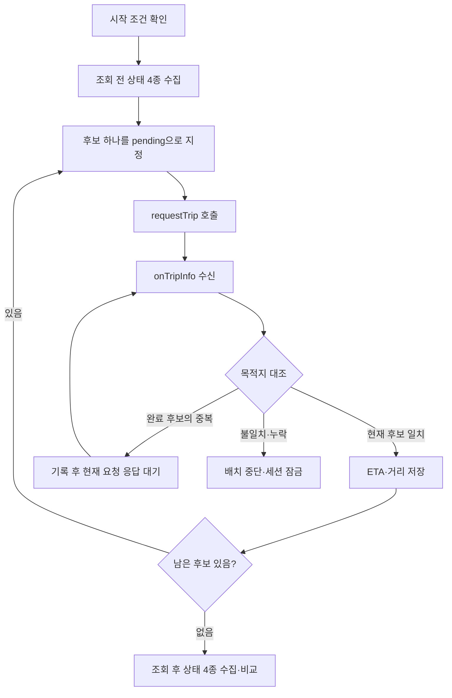

# NaviHelper ETA PoC 구현 참고

실험 당시 구현 기준: 2026-11-06. 실험 환경·고정 후보 좌표·성능 측정·채택 판정은 [실험 보고서](POC_TRIP_REPORT.md)에 기록한다. **PoC 실행 코드·권한·전용 테스트는 실험 종료 후 제거했으며 현재 앱은 빈 메인 화면이다.** 아래 파일명과 흐름은 삭제 전 구현의 기록으로, 후속 개발에 참고하기 위한 설명이다. SDK가 보장하지 않는 계약을 추가하지 않는다.

## 검증 대상과 코드 위치

실험 당시 PoC는 `requestTrip(TripRequest)`을 한 후보씩 호출하고, `onTripInfo(TripInfo)`에서 **현재 내비 위치 → 해당 후보**의 ETA·거리를 수집했다. 4개 고정 후보 중 앞의 1~4개를 선택하며, 역순은 선택한 부분 목록만 뒤집었다. 후보를 방문하는 연속 경로를 만들거나 최종 목적지까지의 우회 시간을 계산하지 않았다.

| 실험 당시 파일 | 실험 당시 책임 |
| --- | --- |
| `TripProbeGateway.kt` | SDK 타입을 노출하지 않는 경계, 후보·응답·이벤트 모델, 목적지 일치 판정 |
| `TripProbeViewModel.kt` | 실행 조건, 후보 순서, 대기 요청 하나 유지, 상태 조회, 응답 검증, 타임아웃·잠금 |
| `PleosTripProbeGateway.kt` | Android NaviHelper 연결, 고정 후보·실측 응답 좌표, SDK 호출·콜백 변환, 로그·파일 기록 |
| `MainRoute.kt`, `TripProbeScreen.kt` | ViewModel 주입·StateFlow 구독, 실행 조작과 후보별 진단 결과 표시 |
| `JuyulowApplication.kt`, `MainModule.kt` | 앱의 Gateway factory와 feature의 ViewModel constructor 등록 |

`app → feature:main` 의존 방향을 유지하며, Android SDK 어댑터는 `app`에 둔다. 순수 Kotlin/JVM인 `core:data`에 Android 의존성을 추가하지 않았다.

## SDK 연결과 후보 구성

1. 앱 매니페스트에 `pleos.car.permission.NAVI_ROUTE`를 선언한다. 대상 에뮬레이터에서 normal 권한으로 확인했으므로 런타임 권한 팝업은 요청하지 않는다.
2. ViewModel 생성 시 `gateway.connect()`를 호출한다. 어댑터는 application context로 `NaviHelper`를 생성하고 `initialize(onConnected, onFailed)`를 사용한다.
3. 연결 성공 후 동일한 `NaviHelperEventListener` 인스턴스를 등록하고 `Connected`와 고정 후보 목록을 전달한다. 초기 연결 실패·동기 예외는 `Failure`로 전달한다.
4. 최근 목적지·즐겨찾기와 초기 내비 상태도 조회한다. 후보 목록은 ID 중복 제거·좌표 범위 검사 후 최대 4개를 유지한다. 현재 어댑터는 고정 후보 4개를 먼저 전달하므로 뒤늦은 최근 목적지 응답이 이 목록을 교체하지 않는다. 결과 행이 생긴 뒤에는 후보 갱신을 받지 않는다.

`ProbeCandidate`는 요청용 `id`, `name`, `latitude`, `longitude`, nullable `subId`와 검증용 `responseLatitude`, `responseLongitude`를 가진다. 검증 좌표의 기본값은 요청 좌표다. 현재 고정 후보는 실제 반환 좌표가 달라 실측값을 별도로 넣었다. 첫 두 후보는 `calibrated()`가 알려진 ID·요청 좌표 조합을 확인해 보정하고, 나머지 두 후보는 생성 시 실측값을 명시한다.

이 보정은 요청 좌표를 바꾸지 않는다. 임의 후보에 자동 적용하거나 넓은 반경으로 일치를 허용하는 구현도 아니다. 후보를 추가하거나 지도·출발 조건이 바뀌면 단일 조회에서 ID와 반환 좌표를 다시 확인해야 한다.

## 배치 실행과 ETA 수집



`start()`는 연결 완료, 실행 중 아님, 잠금 없음, 충분한 후보 수를 확인한다. 2~4개 배치는 먼저 단일 후보 조회와 전후 상태 비교가 성공해 `singlePassed`가 설정되어야 실행할 수 있다. 실행 중에는 후보 수·순서 변경과 중복 시작을 무시한다.

조회 전 상태 수집이 끝나면 `next()`가 `sequence[completed.size]`를 고른다. 후보를 `pending`에 넣고 요청 시각과 30초 타이머를 설정한 뒤 어댑터를 호출한다. 동시에 진행하는 Trip 요청은 하나다.

실제 SDK 요청 매핑은 다음과 같다.

```kotlin
helper.requestTrip(
    TripRequest(
        candidate.latitude,
        candidate.longitude,
        candidate.id,
        candidate.name,
        candidate.subId,
    )
)
```

이 요청에는 출발지, 실행 ID, 요청 ID, 경로 옵션을 넣지 않는다. SDK 모델에 해당 입력 필드가 없다. `requestRoute()`, 경유지 추가, 안내 취소 등 내비 안내를 변경하는 API도 이 조회 흐름에서 호출하지 않는다.

`onTripInfo()`는 먼저 원본 전체를 기록하고, `summary.routePoints` 중 `pointType == DESTINATION`인 지점들을 추려 `ProbeTrip`으로 변환한다. `eta`는 `etaSeconds`, `distance`는 `distanceMeters`로 전달한다. SDK 콜백은 ViewModel의 `viewModelScope.launch`를 통해 Main Dispatcher에서 순서대로 처리한다.

`matchTrip()` 판정은 다음과 같다.

| 조건 | 처리 |
| --- | --- |
| 목적지가 정확히 하나이고, 비어 있지 않은 POI ID와 실측 응답 좌표가 현재 후보에 일치 | `CURRENT` |
| 현재 후보에는 맞지 않지만 완료 목록의 후보에 같은 기준으로 일치 | `COMPLETED_DUPLICATE`: 기록 후 무시하고 현재 요청 계속 대기 |
| 목적지 없음·여러 개·알 수 없는 ID·좌표 불일치 | `INVALID`: 성공 처리하지 않고 배치 중단·잠금 |

좌표는 위도·경도 각각 절대 차이 `0.000001°` 이내여야 한다. 이름은 화면 표시용이며 일치 판정에 쓰지 않는다. 응답 목적지에는 sub ID를 매핑하지 않으므로 sub ID 기준 식별도 수행하지 않는다.

`CURRENT`여도 ETA나 거리가 음수이면 중단한다. 유효하면 타이머 취소 → 후보별 ETA·거리·수신 시각·응답 지연 기록 → 완료 목록 추가 → `pending` 비우기 → `next()` 순서로 진행한다. UI는 초·미터 원본과 분·km 환산값을 표시한다. 마지막 후보 다음에는 상태를 다시 조회하고 비교한다.

## 기존 안내 상태 비교와 종료 조건

`snapshot()`은 `getCurrentLocationInfo()`, `getDestinationInfo()`, `getWaypointInfo()`, `getRouteStateInfo()`를 호출한다. 각 콜백의 원본을 기록하고 다음 비교 키를 만든다.

| 종류 | 비교 키 |
| --- | --- |
| 위치 | 위도·경도 |
| 목적지 | POI ID·위도·경도 |
| 경유지 | 순서를 유지한 POI ID·위도·경도 목록 |
| 경로 상태 | `naviMode`, `isRouting`, `routeOption` |

교통 정보·남은 시간·연료 수치 등은 원본에 보존하되 비교 키에는 넣지 않는다. `collectSnapshot()`은 4종 키가 모두 올 때까지 기다리며, 10초 내에 모이지 않거나 호출 예외가 나면 중단한다. 전후 키가 모두 같으면 배치 실행을 해제하고, 다르면 상태 변경을 기록하고 세션을 잠근다.

`snapshotLabel`은 앱 내부에서 `initial`, `before:<run>`, `after:<run>`, `aborted:<run>`을 구분하기 위한 값이다. SDK가 돌려주는 요청 ID가 아니므로 지연된 스냅샷 응답을 완전히 구별하거나 일관된 한 시점의 상태를 보장하지 못한다. 실제 안내 활성 여부도 `isRouting` 하나로 판단하지 않는다. 실험에서는 안내 화면이 활성인데 이 값이 false였다.

| 상황 | 현재 처리 |
| --- | --- |
| Trip 응답 30초 누락 | 대기 작업 취소·후속 요청 차단·잠금 |
| 실행 중 `onError` 또는 동기 예외 | 오류 기록·중단·잠금 (`CAUSE_SEARCH_TRIP` 포함) |
| 사용자 중단 | SDK 취소를 가정하지 않고 앱의 대기·후속 요청을 중단·잠금 |
| 목적지 식별 실패·음수 값 | 원본/진단값을 남기고 중단·잠금 |
| 대기 요청이 없는 TripInfo | 기록만 하고 결과로 저장하지 않음 |
| 실패 후 | `aborted` 상태 조회를 시도하되 배치를 자동 재시작하지 않음 |

`fail()`은 현재 대기 요청·스냅샷 완료 작업을 비우고 `running=false`, `locked=true`로 만든다. 잠금은 해당 ViewModel 세션에서 해제하는 UI가 없다. 재시도·재연결·리스너 재등록이 이전 서버 요청을 취소한다고 가정하지 않는다.

## 수명과 로그·시간 측정

SDK와 실험 상태는 ViewModel 수명을 따른다. Compose 재구성이나 Activity 재생성에서 매번 연결·실험을 시작하지 않는다. 화면을 벗어나도 진행 중인 유한 배치는 계속 수집하며, 자동 반복이나 상시 폴링은 하지 않는다. `onCleared()`에서는 타이머를 취소하고 동일 리스너 제거 → `release()` → 로그 writer 종료 순서로 정리한다. 프로세스 종료 후 UI 결과 복원은 구현하지 않았다.

어댑터는 전용 `TripProbe` logcat 태그와 앱 내부 `files/trip-probe/<UUID>.jsonl`에 기록한다. 파일 쓰기는 단일 executor에서 수행하고, 각 행은 wall-clock `timeMillis`, 단조 시각 `elapsedMillis`, 이벤트 `kind`, 상세 문자열 `detail`을 가진다. SDK 데이터는 데이터 클래스의 전체 문자열 표현을 보존한다. 파일 기록 실패는 별도 오류 로그로 남긴다.

| 시간 | 측정 구간 |
| --- | --- |
| 후보별 지연 | `sentAt` 설정부터 유효한 응답을 처리해 UI 행에 기록할 때까지 |
| 화면 진단의 `완료: ...ms` | 배치 시작부터 마지막 후보 결과 처리까지. **전 상태 조회 포함**, 후 상태 조회 제외 |
| 추가 실험의 순수 ETA 수집 시간 | 첫 `request` 기록부터 마지막 `trip_raw` 기록까지. 후보 사이 순차 처리는 포함, 전후 상태 조회·UI 조작은 제외 |
| 상태 확인 포함 전체 시간 | `batch_start`부터 전후 상태 비교 완료 진단 기록까지 |

지연 계산에는 `SystemClock.elapsedRealtime()`을 사용한다. 기록용 벽시계와 지연 계산을 섞지 않는다. 긴 logcat 행은 잘릴 수 있으므로 성능 분석은 JSONL 원본을 사용한다. 실제 수집 시간과 후보까지의 주행 ETA는 서로 다른 값이다.

## 후속 개발에서 유지할 주의점과 검증

요청 ID가 없으므로 **같은 후보의 이전 실행 응답과 새 실행 응답은 ID·좌표가 같으면 구분할 수 없다.** `run`이나 파일 UUID는 이 문제를 해결하지 못한다. `matchTrip()`도 그 경우를 `CURRENT`로 판단할 수 있다. 서버 취소·최대 지연·중복 전달 계약이 확인되기 전에는 이 PoC를 임의 후보 재조회에 대한 완전한 보장으로 사용하지 않는다.

고정 후보의 실측 응답 좌표, 주차·고정 위치, 해당 내비 버전이라는 실험 조건도 함께 유지해야 한다. 현재 위치를 옮겨 재계산되는지, 실제 주유소 데이터의 POI ID가 호환되는지, 후보 경유 후 최종 목적지까지의 추가 비용을 구할 수 있는지는 별도 과제다.

실험 당시 검증은 `TripProbeViewModelTest.kt`와 `TripProbeRecreationTest.kt`로 수행했다. 두 전용 테스트는 PoC 정리와 함께 제거했다. Fake 테스트의 오류·지연·중복 검증과 실제 SDK 실험 결과를 구분한다. 빌드·검증 명령은 [TESTING.md](../TESTING.md), SDK 원문을 찾는 진입점은 [로컬 Pleos SDK 가이드](../../pleos_sdk_guide/README.md)를 참고한다.
